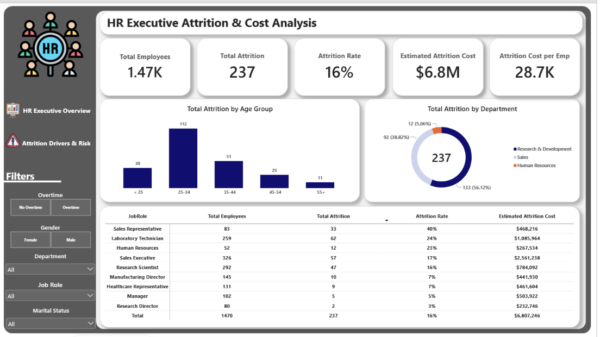
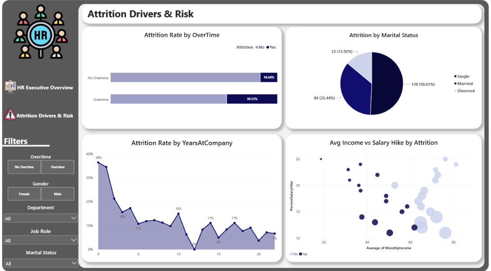

# HR Attrition & Cost Analysis Dashboard

An executive Power BI dashboard that shows **why employees leave** and **what it costs the company**.

**Tools:** Power BI · DAX · Power Query · Excel

**Dataset:** IBM HR Analytics Employee Attrition dataset (1,470 employees)




## Business question
Which employees are most likely to leave, which factors drive it, and how much does attrition cost?

## Key findings
- **Overtime is the strongest driver.** Attrition is **30.5%** for employees working overtime vs **10.4%** for those who don't, nearly 3x.
- **237 of 1,470 employees left (16%)**, an estimated cost of **$6.8M**, about **$28.7K per leaver**.
- **Highest-risk roles:** Sales Representatives **40%** (33 of 83), Laboratory Technicians **24%**.
- **Sales Executives** carry the highest total cost (**$2.56M**) because the group is large, even though their rate is 17%.
- The **25–34** age group lost the most people (**112**). Attrition is highest in the first year at the company (36%).
- Half of all leavers are single (50.6%).

## Recommendations
1. Re-balance workload in departments with heavy overtime to reduce burnout.
2. Offer mentoring and clear career progression to employees aged 25–34.
3. Review pay and working conditions for Sales Representatives and Laboratory Technicians.

## What's in the dashboard
- **Page 1, HR Executive Overview:** KPIs (employees, attrition, attrition rate, estimated cost, cost per employee), attrition by age group and department, and a job-role table.
- **Page 2, Attrition Drivers & Risk:** attrition by overtime, marital status, years at company, and income vs salary hike.
- Slicers: overtime, gender, department, job role, marital status.

## How it was built
1. Cleaned and modeled the data in Power Query.
2. Wrote custom DAX measures for Attrition Rate, Estimated Attrition Cost and Cost per Employee.
3. Added a custom sort order so age brackets read in logical order.
4. Designed a dark-themed UI with page navigation.

## Key DAX measures
```dax
-- Paste your real measures here, for example:
-- Attrition Rate = DIVIDE(CALCULATE(COUNTROWS(HR), HR[Attrition] = "Yes"), COUNTROWS(HR))
```


## Links
- LinkedIn post: *([add your post link](https://www.linkedin.com/posts/mahmoud-hamdy-473732417_powerbi-dataanalytics-hranalytics-ugcPost-7507941508042498049-d8Tp/?utm_source=share&utm_medium=member_desktop&rcm=ACoAAGoBRxcBUAFXeC8DTpHtxT4cV6FtUzC_2AI))*
